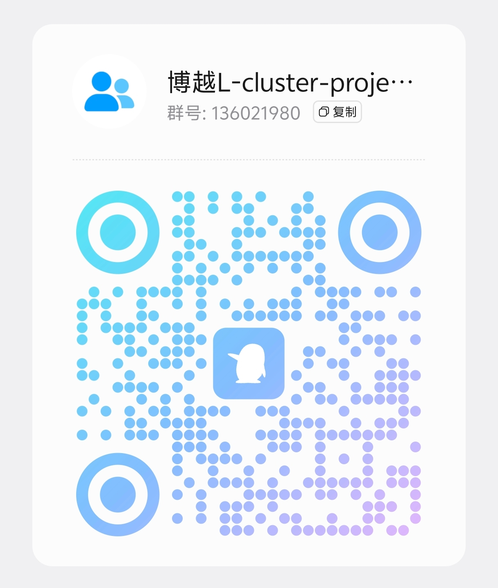

# 仪表投屏 Cluster Projector

[](LICENSE)


面向 Android 多屏车机的仪表盘投屏实验工程，当前重点适配：

- 吉利 FX11 / 博越 L 2022 款
- 银河 NOS 2.3
- Android 11，`RQ3A.211001.001`
- 亿咖通 ecarx 定制系统

> 本项目由 AI 辅助原创开发，仅用于自有设备的学习、调试和源码恢复。实车操作请停车进行。工程不包含 root、系统签名伪装、权限绕过、受保护内容抓取或厂商私有接口调用。

> **实车测试优先说明：项目目前仍处于 FX11 / 银河 NOS 适配测试阶段，不同车机固件、仪表合成策略和目标 App 安全策略都会影响结果。**
>
> 1. **首次投屏测试请优先选择吉利系统地图：`com.geely.map`**，并确认首页“系统应用”开关已开启。
> 2. 请先点击 **“先预检仪表，再测试投屏”**；仪表盘能看到预检色块后，再继续地图投屏测试。
> 3. `com.geely.carlink`、第三方地图和其他应用建议在系统地图测试完成后再逐个对比。
> 4. `com.geely.gallery` 是图库/USB 相关组件，不是地图包名，不要作为地图测试目标。
> 5. 测试后无论成功还是失败，都请通过 **“查看日志文件 → 分享完整日志”** 提交完整 `.log` 文件，帮助确认是 Display 策略、直出权限、镜像帧链路，还是目标 App 安全限制导致的问题。
> 6. 如果系统分享面板异常，请按 [FX11 日志提交指南](docs/LOG_SUBMISSION_FX11.md) 使用 LocalSend 发送：`Download/clusterprojector/clusterprojector-diagnostic-*.log`。
>
> 仅凭“系统应用”身份不能保证可被普通第三方 App 直出到仪表盘；是否支持仍需以实车 Presentation 预检、投屏结果和完整日志为准。

## 社区交流

遇到问题、想反馈需求，或一起讨论 FX11 / 博越 L、银河 NOS、多屏车机适配，欢迎加入 QQ 交流群：

- 群号：**136021980**
- 扫码加入：

<p align="left">
  
</p>

> 群内主要用于项目交流、实车现象反馈和日志协助分析。请勿在群里发送账号、验证码、精确行踪、联系人等隐私信息；提交日志前也建议自行删除个人敏感内容。

---

当前 Demo：

```text
applicationId = org.clusterprojector.app
versionCode   = 12
versionName   = 1.2.9-fx11-ui-readability
minSdk        = 23
targetSdk     = 28
```

---

## 目录

1. [社区交流](#社区交流)
2. [当前能力](#当前能力)
3. [工作链路](#工作链路)
4. [模式差异与边界](#模式差异与边界)
5. [FX11 显示参数](#fx11-显示参数)
6. [工程结构](#工程结构)
7. [编译与打包](#编译与打包)
8. [安装和操作流程](#安装和操作流程)
9. [权限卡片说明](#权限卡片说明)
10. [手机与车机环境差异](#手机与车机环境差异)
11. [FX11 日志提交与辅助工具](#fx11-日志提交与辅助工具)
12. [FX11 中控屏可读性适配](#fx11-中控屏可读性适配)
13. [日志与实车判断](#日志与实车判断)
14. [核心库调用](#核心库调用)
15. [已知限制和后续计划](#已知限制和后续计划)
16. [免责声明](#免责声明)

---

## 当前能力

### 1. 双模式自动降级

- **直出模式，默认优先**
  - 在仪表 Display 上创建窗口；
  - 通过 `MediaProjection#createVirtualDisplay()` 创建独立虚拟屏；
  - 使用公开 API `ActivityOptions.setLaunchDisplayId()` 尝试把 App 启动到虚拟屏；
  - 不做 H.264/H.265 视频编码，资源占用更低；
  - 如果车机策略允许，中控和仪表可以运行不同内容。

- **无编码 GL 镜像兜底**
  - 直出虚拟屏创建失败、测试 Activity 启动失败，或直出启动第三方 App 明确失败时自动切换；
  - 捕获中控 Display 0；
  - 通过 OpenGL ES OES 外部纹理直接渲染到仪表窗口；
  - 没有视频编码、解码和网络传输；
  - 兼容性通常更高，但仪表画面跟随中控前台内容。

### 2. 仪表窗口控制

支持实时调整：

- 水平位置 X；
- 垂直位置 Y；
- 宽度；
- 高度；
- 透明度。

控制区默认折叠，点击“图层控制”展开；投屏开始后会自动展开，方便在中控屏上调整仪表窗口。

### 3. FX11 屏幕识别

自动枚举当前进程可见 Display，并优先选择 `1920×532@320dpi` 的仪表长条屏，降低误选 HUD 或副驾屏的概率。

### 4. 权限状态可视化

首页顶部固定显示“权限检查”卡片：

- 悬浮窗权限缺失时标红并直达设置；
- MediaProjection 被拒绝后可再次发起系统授权；
- 通知/日志等可选权限缺失时给出申请入口；
- 应用列表为 0 时直达应用详情；
- MIUI/HyperOS 手机上额外提示检查“获取应用列表”。

### 5. 应用选择与测试画面

- 同时枚举第三方应用、系统应用和厂商预装应用；
- 优先扫描所有已安装包，再用 Launcher Intent 兜底，只展示存在前台启动入口的应用；
- “系统应用”开关默认开启，关闭后仅显示第三方应用；
- 列表中以“系统 · 包名”和“三方 · 包名”区分来源；
- 可点击任意可启动 App 尝试投屏；
- 点击测试后先显示不依赖录屏授权的官方 Presentation 预检画面；只有用户确认仪表能看到，才继续 MediaProjection、Surface 和 VirtualDisplay 链路；
- 已建立投屏会话后切换 App 时不会重复弹出 MediaProjection 授权框。

### 6. 诊断日志

关键流程写入本地日志：

- 优先目录：`/sdcard/Download/clusterprojector/`
- 兜底目录：`/Android/data/org.clusterprojector.app/files/clusterprojector-logs/`

没有公共存储权限时自动使用应用专属目录，不影响核心投屏。

从 v1.2.7 起，点击首页“查看日志文件”后可直接选择“分享完整日志”。App 会把设备信息、权限状态、可见 Display、投屏控制器状态、全部本地日志和崩溃堆栈打包为一个 `.log` 文件附件。v1.2.8 起还会额外复制一份到 `Download/clusterprojector/`，方便在银河 NOS 分享面板受限时用 LocalSend 直接选择文件。

### 7. FX11 中控屏可读性适配

v1.2.9 针对博越 L / FX11 中控屏 `1440×1920@160dpi` 增加专门的大屏资源：

- 车机大屏自动放大标题、正文、按钮、应用列表、Spinner、弹窗和 Toast；
- 三个主要操作按钮在车机横向上合并为同一行，给应用列表保留更多空间；
- 应用名称和包名允许自动换行，减少长包名被截断；
- 手机/小屏继续使用紧凑布局，避免普通手机界面被放大后溢出；
- 已用 `1440×1920@160dpi` 模拟器配置检查首屏、展开图层控制和应用列表，无越界节点。

---

## 工作链路

### 直出模式

```text
MainActivity
  └─ ScreenCastService 获取 MediaProjection 授权和前台服务
      └─ CastController
          └─ OverlayWindowHost 优先用官方 Presentation 在仪表 Display 创建窗口，失败再回退悬浮窗
              └─ SurfaceView
                  └─ VirtualScreenHost 创建独立 VirtualDisplay
                      └─ ActivityOptions.setLaunchDisplayId() 启动目标 App
```

直出虚拟屏 flags：

```java
VIRTUAL_DISPLAY_FLAG_PUBLIC
        | VIRTUAL_DISPLAY_FLAG_PRESENTATION
        | VIRTUAL_DISPLAY_FLAG_OWN_CONTENT_ONLY
```

### GL 镜像兜底

```text
MainActivity
  └─ ScreenCastService 获取 MediaProjection
      └─ CastController
          └─ OverlayWindowHost 优先用官方 Presentation 在仪表 Display 创建窗口，失败再回退悬浮窗
              └─ MirrorGlSurfaceView
                  └─ MirrorCaptureHost 捕获中控 Display 0
                      └─ OpenGL OES 纹理直接合成到仪表窗口
```

镜像虚拟屏 flags：

```java
VIRTUAL_DISPLAY_FLAG_AUTO_MIRROR
        | VIRTUAL_DISPLAY_FLAG_PRESENTATION
```

两种模式都不做视频编码。区别是：直出尝试建立独立任务屏，镜像只把中控已有画面搬到仪表。

---

## 模式差异与边界

| 能力 | 直出模式 | GL 镜像兜底 |
|---|---|---|
| 是否视频编码 | 否 | 否，OpenGL 纹理搬运 |
| 资源占用 | 最低 | 有额外 GPU 合成开销 |
| 中控/仪表是否独立 | 理论上可以，取决于 OEM 多 Display 策略 | 不独立，仪表跟随中控前台 |
| 普通第三方 App | 可能被系统重定向或拒绝 | 通常可镜像中控上可见的内容 |
| 预装定制 App | 被白名单放行概率较高，仍需实车验证 | 通常随中控前台镜像 |
| `FLAG_SECURE` 内容 | 可能黑屏或失败 | 可能黑屏或无法捕获 |
| 覆盖官方仪表图层 | 不保证 | 不保证 |

普通第三方签名应用创建的 VirtualDisplay 不是系统 trusted display。即使设备 SELinux 为 permissive，也不能绕过 Android 的 Display 可见性、Activity 启动、AppOps、多窗口和厂商白名单策略。

定制版高德地图、ICCOA CarLink 等预装应用被车机策略放行的概率通常高于普通第三方 App，但不能在未实车验证前承诺一定可用。

当前自动降级能够覆盖**明确抛出异常或返回失败**的场景。如果系统“不报错但静默把 Activity 放回 Display 0”，需要后续增加前台 Display 检测和手动强制镜像开关。

---

## FX11 显示参数

| 项目 | 参数 |
|---|---|
| 车型 | 吉利博越 L 2022 款 / FX11 |
| 系统 | 银河 NOS 2.3 |
| Android | 11，`RQ3A.211001.001` |
| 平台 | 亿咖通 ecarx |
| 中控屏 | Display 0，`1440×1920@160dpi` |
| HUD/小屏 | Display 1，`800×480@320dpi`，排除或降权 |
| 副驾/娱乐屏 | Display 2，`2880×1080@160dpi`，排除或降权 |
| 首选仪表屏 | Display 3，`1920×532@320dpi` |
| 备选仪表屏 | Display 4，`1920×532@320dpi` |

v1.2.6 诊断阶段默认直出窗口：

```text
1920×532，x=0，y=0
```

即先全屏输出，最大化确认仪表物理合成层是否接受 Presentation。预检成功后，可通过界面滑块缩小、移动和调节透明度。

镜像模式默认 contain 中控竖屏：高度填满仪表屏，宽度按中控屏宽高比计算，水平居中并保留黑边。

---

## 工程结构

```text
cluster-projector/
├── app/
│   └── src/main/
│       ├── java/org/clusterprojector/app/
│       │   ├── MainActivity.java              # 控制面板、权限卡片、Display/应用选择
│       │   ├── ScreenCastService.java         # MediaProjection 前台服务
│       │   ├── CastAccessibilityService.java  # 可选预留，当前核心链路不依赖
│       │   ├── TestCastActivity.java          # 仪表链路测试画面
│       │   ├── AppLog.java                    # 本地诊断日志和诊断包导出
│       │   ├── LogShareProvider.java          # 只读日志分享 Provider
│       │   ├── ClusterApp.java                # Application，初始化日志
│       │   ├── CrashHandler.java              # 崩溃记录
│       │   └── BootUpReceiver.java            # 可选开机入口
│       ├── res/
│       │   ├── layout/activity_main.xml       # 主控制面板
│       │   └── layout/app_list_item.xml       # 应用列表项
│       └── AndroidManifest.xml
│
├── clusterdisplay/
│   └── src/main/java/org/clusterprojector/display/
│       ├── CastController.java                # 直出优先 + 自动降级核心
│       ├── ClusterPresentationProbe.java       # 不依赖录屏授权的官方副屏预检
│       ├── DisplayEnumerator.java             # Display 枚举与评分
│       ├── DisplayTarget.java                 # Display 描述对象
│       ├── Fx11DisplayProfile.java            # FX11 参数、评分、默认窗口
│       ├── OverlayWindowHost.java             # 仪表 Display 上的 Presentation/悬浮窗宿主
│       ├── VirtualScreenHost.java             # 直出 VirtualDisplay
│       ├── MirrorCaptureHost.java             # 中控 Display 0 捕获
│       ├── MirrorGlSurfaceView.java           # 无编码 OpenGL 镜像渲染和首帧日志
│       ├── ClusterLog.java                    # 核心库本地日志
│       └── WindowGeometry.java                # X/Y/宽/高数据
│
└── README.md
```

`clusterdisplay` 是零三方依赖的 Android Library，仅使用 Android Framework，可单独输出 AAR 给其他工程复用。

---

## 编译与打包

### 环境要求

- JDK 17
- Android SDK Platform 34
- Gradle 8.4
- Android Gradle Plugin 8.1.4

### 完整构建

```bash
./gradlew clean :app:assembleDebug :app:lintDebug :clusterdisplay:assembleDebug
```

产物：

```text
app/build/outputs/apk/debug/app-debug.apk
clusterdisplay/build/outputs/aar/clusterdisplay-debug.aar
```

仓库不提交预编译 APK，避免二进制文件反复进入 Git 历史。需要安装时，请先本地执行构建，再从 `app/build/outputs/apk/debug/app-debug.apk` 取包。

当前 Debug 包使用调试签名，适合自有车机安装验证，不用于应用商店分发。

### 为什么 targetSdk 是 28

FX11 为 Android 11，部分车机预装和定制应用仍停留在旧 targetSdk。本工程使用 targetSdk 28 是为了减少新版系统后台、存储和兼容性策略对实车验证的干扰。该选择不用于绕过运行时权限，悬浮窗和 MediaProjection 仍由用户明确授权。

---

## 安装和操作流程

### FX11 安装

```bash
adb connect <FX11_IP>:5555
adb install -r app/build/outputs/apk/debug/app-debug.apk
```

如果车机 adb 允许修改 AppOps，也可以执行：

```bash
adb shell appops set org.clusterprojector.app SYSTEM_ALERT_WINDOW allow
```

如果该命令在车机上受限，可以直接在 App 首页点击权限卡片按钮，进入系统设置手动允许。

仓库源码不包含根目录 APK；每次修改后请重新执行 Gradle 构建，再安装 `app/build/outputs/apk/debug/app-debug.apk`。

### 推荐验证顺序

1. 打开“仪表投屏”。
2. 先处理首页“权限检查”卡片中的缺失权限。
3. 在“目标显示设备”中选择 `1920×532@320dpi` 的仪表屏。
4. 点击“先预检仪表，再测试投屏”。
5. 此时先不弹录屏授权，仪表盘应出现全屏闪烁色块和“仪表副屏预检”文字。
6. 如果仪表看不到预检画面，直接点“没看到”并分享日志；这说明标准 Presentation 也被仪表合成层拦截。
7. 如果能看到预检画面，点“看到了，继续”，再按提示处理悬浮窗权限并在系统 MediaProjection 弹窗中确认。
8. 观察仪表是否出现内置测试画面。
9. 如果 App 直出失败，等待自动切换到 GL 镜像；镜像模式会在中控打开目标 App，再把真实捕获帧送到仪表。
10. 展开“图层控制”，调整位置、大小和透明度。
11. 确认测试画面正常后，再点击应用列表中的定制版高德地图或 ICCOA CarLink。
12. 最后再测试普通第三方 App。
13. 如果仪表无画面，不要先重启 App，点击“查看日志文件 → 分享完整日志”导出本次诊断包。
14. 点击“停止投屏”释放会话。

手机只有 Display 0 时，应用会阻止误启动投屏，这是保护逻辑，不代表车机链路异常。

---

## 权限卡片说明

首页权限卡片会把权限分成核心权限、投屏授权和可选权限。

| 项目 | 是否必需 | 缺失时的处理 |
|---|---:|---|
| 悬浮窗 / 显示在其他应用上层 | 必需 | 卡片按钮直达系统设置 |
| MediaProjection | 投屏时必需 | 点击测试投屏或应用时弹出系统确认；拒绝后卡片可重新发起 |
| 通知权限，Android 13+ | 可选 | 影响前台服务通知可见性，不阻断投屏 |
| 存储权限，Android 12 及以下 | 可选 | 影响公共 Download 日志，拒绝后使用应用专属目录 |
| 应用列表 | 视 ROM 而定 | 列表为 0 时直达应用详情；MIUI/HyperOS 始终保留检查入口 |

权限按钮按优先级处理：

1. 缺悬浮窗：跳悬浮窗设置；
2. MediaProjection 曾被拒绝：重新发起系统授权；
3. 应用列表为 0：打开应用详情；
4. 通知/日志权限缺失：发起运行时权限申请；
5. 如果运行时权限被系统限制再次弹窗：打开应用详情；
6. 普通车机系统权限就绪：提示可以开始投屏；
7. MIUI/HyperOS 手机：即使已能列出 Launcher App，也保留应用详情入口用于检查完整应用列表权限。

从悬浮窗设置返回后，界面会自动刷新。如果是在投屏过程中跳转授权，返回后会继续原投屏流程。

MediaProjection 令牌不能、也不应该静默获取。每次建立新的投屏会话，都必须由用户在系统弹窗中确认。

---

## 手机与车机环境差异

当前开发和界面冒烟使用过：

```text
Redmi K20 Pro
Android 16 / API 36
1080×2340
仅 Display 0
MIUI/HyperOS
```

手机环境只能验证：

- 界面布局；
- 权限卡片；
- 应用列表；
- 设置页跳转；
- Display 0 保护逻辑；
- 崩溃和基础日志。

手机不能验证：

- Display 3/4 仪表物理屏；
- 车机多 Display 启动策略；
- ecarx/SystemUI/QNX 图层合成；
- 定制高德地图和 ICCOA CarLink 白名单；
- 实车仪表置顶效果；
- 直出与镜像的真实性能。

MIUI/HyperOS 可能有独立的“获取应用列表”隐私开关。当前版本会优先通过 `getInstalledApplications()` 合并 Launcher Intent 查询，在测试手机上即使没有手动授予完整应用列表权限，也能列出 97 个可启动应用，其中包含系统/预装应用；如果列表数量异常或为 0，仍需到应用详情中检查该开关。

---

## FX11 日志提交与辅助工具

银河 NOS 可能阉割系统设置或分享面板。为了让实车测试者稳定提交日志，Release 页面同时提供 LocalSend 和授权辅助 APK。详细步骤见：[FX11 实车日志提交指南](docs/LOG_SUBMISSION_FX11.md)。

Release：[v1.2.8-fx11-log-tools](https://github.com/limrbrown74-lab/cluster-projector/releases/tag/v1.2.8)

| 软件 | Release 附件 | 安装位置 | 用途 |
|---|---|---|---|
| 仪表投屏 | `cluster-projector-v1.2.8-fx11-log-tools-debug.apk` | 车机 | 主程序 |
| 银河 OS 系统设置 | `fx11-galaxy-nos-settings-boyue-l.apk` | 车机 | 补回被银河 NOS 阉割的设置/权限入口 |
| LocalSend | `localsend-1.18.2-android-arm64v8.apk` | 车机 | 通过 Wi-Fi/热点把 `.log` 文件发到手机 |
| LocalSend | 手机端从应用商店或 LocalSend 官方渠道安装 | 手机 | 接收车机日志 |
| 权限狗 | `fx11-permission-dog-0.1.0.45.apk` | 车机，可选 | 系统设置入口缺失时辅助授权 |
| 开发者选项 | `fx11-developer-options-1.058.apk` | 车机，可选 | 打开开发者/调试入口 |
| 竖屏应用管家 | `fx11-app-manager-1.8.1-portrait.apk` | 车机，可选 | 管理应用、安装包和权限 |

推荐提交流程：

1. 车机安装系统设置、LocalSend 和仪表投屏；手机安装 LocalSend。
2. 车机和手机连接同一 Wi-Fi/热点。
3. 在仪表投屏中复现问题后，点击“查看日志文件 → 分享完整日志”。
4. 系统分享面板选择 LocalSend；如果没有 LocalSend，就在车机 LocalSend 中手动选择 `Download/clusterprojector/clusterprojector-diagnostic-*.log`。
5. 手机收到 `.log` 文件后再发回。正确文件应以 `clusterprojector-diagnostic-` 开头，不能只有一句 `ClusterProjector FX11 诊断日志`。

辅助 APK 的包名、版本、SHA256 和注意事项见 [FX11 实车日志提交指南](docs/LOG_SUBMISSION_FX11.md) 与 Release 附件 `SHA256SUMS-v1.2.8.txt`。

---

## 日志与实车判断

### 实时日志

```bash
adb logcat -c
adb logcat -s ClusterDisplay:D ClusterOverlay:D ClusterVirtual:D ClusterCast:D ClusterMirror:D ClusterMirrorGL:D ScreenCastService:D MainActivity:D AndroidRuntime:E
```

### 直出成功的典型日志

```text
ClusterOverlay: overlay added to display=3 ...
ClusterOverlay: direct surfaceChanged 1920x532 ...
ClusterVirtual: created 1920x532@320 id=... state=ON ...
ClusterVirtual: startActivity returned without exception ... note=no_exception_does_not_prove_actual_display
ClusterVirtual: system diagnostics ...
```

`startActivity` 不抛异常只能证明调用被系统接受，不能证明目标 Activity 真的留在虚拟 Display。v1.2.5 会追加最佳努力的系统状态片段，用于判断是否被静默重定向回 Display 0。

### 自动降级的典型日志

```text
ClusterCast: fallback to mirror: ...
ClusterOverlay: show MIRROR GL view ...
ClusterMirror: mirror capture started: 1440x1920@160 ...
ClusterMirrorGL: first frame rendered to dashboard surface ...
ClusterCast: mirror first frame received (FIRST) ...
```

如果 8 秒内镜像第一帧没有到达，App 会明确提示并要求分享完整诊断日志。

### 实车重点观察

- 仪表 Display 是否枚举为 Display 3 或 Display 4；
- 窗口是否成功 add 到仪表 Display；
- VirtualDisplay 是否创建成功；
- 目标 Activity 是留在虚拟 Display，还是被系统静默放回 Display 0；
- 是否触发 `fallback to mirror`；
- 镜像画面是否流畅、是否有明显黑边；
- 调整 X/Y/宽高/透明度是否立即生效；
- 是否能盖在原厂仪表图层上方；
- 高德地图、ICCOA CarLink 是否出现黑屏、保护内容或重定向；
- 退出 Activity 或停止服务后资源是否释放。

### 崩溃日志

```bash
adb logcat -d -b crash
```

---

## 核心库调用

```java
DisplayEnumerator enumerator = new DisplayEnumerator(context);
List<DisplayTarget> displays = enumerator.listDisplays();
DisplayTarget cluster = enumerator.findRecommendedDisplay();
Display clusterDisplay = enumerator.resolveDisplay(cluster);

CastController controller = new CastController(context, cluster, clusterDisplay);
controller.setListener(new CastController.Listener() {
    @Override public void onVirtualDisplayReady(int mode, int virtualDisplayId) { }

    @Override public void onModeChanged(int mode, String reason) { }

    @Override public void onAppLaunched(String packageName, boolean success, String error) { }

    @Override public void onError(String message, Throwable cause) { }
});

// MediaProjection 必须由用户通过系统弹窗授权后传入。
controller.start(mediaProjection);

// 先投测试 Activity，再投第三方 App，更便于定位问题。
controller.launchTestScreen(TestCastActivity.class);
controller.launchApp("com.example.map");

controller.setBounds(new WindowGeometry(480, 133, 960, 266));
controller.setAlpha(1.0f);
```

使用库时仍需自行处理：

- MediaProjection 前台服务和授权回调；
- `SYSTEM_ALERT_WINDOW` 特殊权限；
- Android 14+ 的 `mediaProjection` foregroundServiceType；
- 实车 Display 枚举和失败提示。

---

## 已知限制和后续计划

1. 直出能否承载其他 App 由车机多 Display/多窗口策略决定，SELinux permissive 不等于可绕过。
2. GL 镜像兼容性较高，但仪表内容跟随中控前台，不是完全独立的第二屏任务。
3. `TYPE_APPLICATION_OVERLAY` 只在 Android 窗口体系内争取置顶；如果原厂仪表使用 SystemUI 私有 Surface 或 QNX 底层 layer，不保证覆盖。
4. 带 `FLAG_SECURE`、受保护 Buffer 或厂商私有安全通道的内容可能黑屏。
5. 当前 `CastController` 主要由 Activity 持有，Activity 销毁会停止投屏；后续可迁移到前台 Service 长期持有。
6. 自动降级能捕获显式异常，但尚不能识别“系统静默回中控”的全部情况。
7. 尚未提供手动强制镜像开关。
8. 尚未实现仪表触摸/按键反向控制。
9. 尚未实现导航音频、头枕音频或多区音频路由。

建议后续优先级：

1. 检测启动后 Activity 实际所在 Display，识别静默回中控；
2. 增加手动“强制镜像模式”开关；
3. 将 `CastController` 完整迁入 Service；
4. 增加实时 FPS、丢帧和 GPU 耗时显示；
5. 增加仪表反向输入实验开关；
6. 单独研究 Android 音频多 zone/设备路由，不与显示投屏混为一项能力。

---

## 版本记录


### 1.2.9-fx11-ui-readability / versionCode 12

- 针对博越 L / FX11 中控屏 `1440×1920@160dpi` 增加 `sw600dp` 大屏布局资源；
- 放大车机端标题、状态、权限说明、按钮、Spinner、应用列表、弹窗和 Toast 字号；
- 车机端把“预检投屏 / 停止 / 查看日志”合并为同一行操作区，减少垂直占用；
- 应用名称和包名支持自动换行，避免长包名单行截断；
- Display 选择项改为短格式，例如 `D3 · 1920×532 · 320dpi · FX11 首选仪表长条屏`；
- 手机/小屏保留紧凑资源，避免普通手机上按钮和列表溢出。

### 1.2.8-fx11-log-tools / versionCode 11

- 修复实车日志提交链路：分享时只发送 `.log` 文件附件，不允许分享器退化成纯文本；
- 点击“分享完整日志”时，除应用私有缓存附件外，会额外复制一份到 `Download/clusterprojector/`，方便 LocalSend 在系统分享面板被阉割时直接选择文件；
- Release 附带银河 NOS 设置、LocalSend、权限狗、开发者选项、竖屏应用管家等 FX11 调试辅助 APK；
- README 增加车机/手机 LocalSend 日志提交流程和辅助工具 SHA256 校验值。

### 1.2.7-fx11-probe-logfix / versionCode 10

- 修复“分享完整日志”可能只发送 `ClusterProjector FX11 诊断日志` 一段文字、没有附件的问题；
- 分享 Intent 改为只携带 `content://` 文件流，MIME 使用 `application/octet-stream`，不再携带 `EXTRA_TEXT`；
- 诊断包扩展名从 `.txt` 改为 `.log`，更明确地要求系统分享器按文件发送；
- 调起分享前通过应用自身的只读日志 Provider 查询文件名/大小并读取首字节，提前发现空附件或 Provider 不可读；
- 保留 v1.2.6 的录屏前 Presentation 仪表预检能力。

### 1.2.6-fx11-presentation-probe / versionCode 9

- 根据 v1.2.5 实车日志调整：普通 overlay 逻辑上位于 Display 3/4，但仪表物理屏没有任何合成输出；
- 在录屏授权前新增原生 `Presentation` 预检：仪表必须先能看到全屏闪烁色块，才继续后续投屏链路；
- 输出宿主改为优先使用 Android 官方 `Presentation`，这是普通第三方 App 向受支持副屏输出内容的标准窗口；
- Presentation 被车机拒绝时，才回退到原 `TYPE_APPLICATION_OVERLAY` 路径；
- 诊断阶段直出默认使用 1920×532 全屏测试画面，先证明仪表物理合成层接受窗口，确认后再手动缩小；
- 修正镜像“第一帧”判定：只有 MediaProjection 真正产出并被 GL 消费第一帧后才提示成功，不再把投影建立前的空 GL 自绘误判为已出图；
- 日志增加 `ClusterProbe`、`host=PRESENTATION/OVERLAY`、Presentation 生命周期和窗口状态，可直接判断标准副屏窗口是否被系统接受；
- 镜像模式必须收到并消费真实 MediaProjection 帧后才提示第一帧成功，中控打开 App 不再被误判为仪表已出图。

### 1.2.5-fx11 / versionCode 8

- 授权成功但仪表无画面的专项诊断版；
- 全链路记录 Display 解析、窗口 addView、窗口实际 Display、Surface 创建/销毁、VirtualDisplay 状态、Activity 启动结果、自动降级、GL 输入 Surface 和第一帧；
- “查看日志文件”弹窗新增“分享完整日志”，通过系统分享面板导出包含设备、权限、Display、控制器状态、普通日志和崩溃堆栈的 `.txt` 诊断包；
- 镜像模式新增第一帧状态反馈和 8 秒未到达提示；
- 直出启动后追加 VirtualDisplay 状态探测和最佳努力系统诊断片段，用于识别“不报错但回到 Display 0”的车机策略。

### 1.2.4-fx11 / versionCode 7

- 兼容部分 ecarx Android 11 framework 缺失 `Context.createWindowContext(Display,int,Bundle)` 的情况；
- 标准 WindowContext 不可用时回退到 DisplayContext，避免授权后立即 `NoSuchMethodError` 崩溃。

### 1.2.3-fx11 / versionCode 6

- 应用列表同时包含第三方应用、系统应用和厂商预装应用；
- 新增“系统应用”显示开关，默认开启；
- 列表项增加“系统 / 三方”来源标识；
- 枚举方式改为已安装应用扫描 + Launcher Intent 兜底，仅展示具有前台启动入口的包。

### 1.2.2-fx11 / versionCode 5

- 新增首页“权限检查”卡片；
- 悬浮窗、MediaProjection、通知/日志、应用列表状态可视化；
- 权限缺失时提供直达设置或重新授权入口；
- MIUI/HyperOS 手机上保留“获取应用列表”手动检查入口；
- 压缩权限卡片高度，图层控制默认折叠，投屏开始后自动展开；
- 使用 Launcher Intent 枚举可启动 App；
- 仓库不再提交根目录预编译 APK，只保留源码和 Gradle 构建产物路径；
- 清理未实际使用的权限声明，保留无障碍预留、状态点资源和开机入口；
- 完整通过 Debug 构建、AAR 构建和 lint 检查；当前 lint 为 0 error、45 warning（主要为硬编码中文、图标规范和绘制优化提示）。

### 1.2.1-fx11

- 实现直出优先、无编码 OpenGL 镜像自动降级；
- 增加 FX11 Display 评分和 `1920×532@320dpi` 识别；
- 增加窗口位置、大小、透明度控制；
- 增加测试画面、诊断日志和 MediaProjection 前台服务。

---

## 免责声明

请在安装、编译、修改或分发本项目前仔细阅读本节。使用本项目即表示你已知晓并接受以下条款。

### 1. 合法使用与设备授权

- 本项目仅可用于你本人拥有、已获得合法授权的车辆和设备，用途限于学习、互操作调试、自有软件恢复和功能验证。
- 不得将本项目用于未经授权的车辆、设备、应用或系统，不得用于规避厂商访问控制、安全策略、付费限制或法律法规要求。
- 你需要自行确认所在国家或地区的法律、车辆使用条款和软件许可要求；因使用场景不合法或未获授权造成的后果由使用者自行承担。

### 2. 不提供绕过能力

本项目不包含、也不鼓励实现以下能力：

- root 提权、系统签名伪装、证书或身份伪造；
- 静默授予悬浮窗、MediaProjection、无障碍或其他 Android 权限；
- 绕过 Android/ecarx 多 Display、Activity 启动、AppOps、SELinux 或厂商白名单策略；
- 抓取受 `FLAG_SECURE`、DRM、受保护 Buffer 或厂商私有安全通道保护的内容；
- 破解、脱壳、修改第三方应用或规避其安全机制。

SELinux permissive、调试连接或侧载安装均不代表普通应用可以突破系统显示和权限边界。

### 3. 驾驶安全

- 实车调试请在停车且确保安全的环境下进行，请勿在驾驶过程中安装、授权、选应用或调整窗口。
- 本项目产生的仪表画面可能出现黑屏、延迟、错位、遮挡、闪退或与原厂仪表信息不一致。
- 车速、电量、报警、辅助驾驶、导航提示等关键信息必须以车辆原厂仪表、车机提示和实际道路为准；本项目不得作为安全关键信息来源。

### 4. 功能与兼容性限制

- 本软件按“原样”提供，不附带任何明示或暗示的适销性、特定用途适用性、稳定性、准确性或不侵权担保。
- 不同车型、系统版本、厂商策略、预装应用版本和 Display 拓扑可能导致行为不同；手机环境的验证结果不代表 FX11 实车结果。
- 是否能够直出到仪表、承载系统/第三方 App、覆盖原厂仪表图层或长期后台运行，均取决于系统策略，作者不保证所有设备可用。
- 升级车机系统、目标应用或本工程后，原有功能可能失效。

### 5. 第三方应用与内容

- 本项目仅提供显示链路实验能力，不提供地图、CarLink、音乐或其他第三方内容。
- 被投屏应用的版权、商标、服务条款、隐私政策、许可证和内容责任归对应权利人所有。
- 如被投屏应用的协议禁止镜像、外显、二次分发或车机外显示，应遵守该协议或许可要求。

### 6. 数据与隐私

- 本工程不会主动上传车辆、应用列表、日志或媒体内容到作者服务器。
- 应用列表、系统信息和诊断日志仅在本机展示或写入本地文件；分享日志或 APK 前，请自行删除车辆识别码、账号、IP、位置、联系人、导航记录等敏感信息。
- 你在自行修改版本中加入联网、统计、账号或文件访问能力时，应独立履行告知、同意和合规义务。

### 7. 分发与修改风险

- 你可以依据 MIT License 修改和再分发，但不得冒用吉利、亿咖通、高德、ICCOA/CarLink 等公司或相关权利人的名义进行背书。
- 再分发源码或二进制时，请保留许可与免责声明，并明确说明你的修改内容、签名方式和适用风险。
- Debug APK 仅用于测试，不承诺长期兼容、升级签名一致或适合正式分发。

### 8. 责任限制

在适用法律允许的最大范围内，作者和贡献者不对因安装、编译、修改、使用或无法使用本项目造成的任何直接或间接损失承担责任，包括但不限于车辆功能异常、数据丢失、设备不可用、交通事故、商业损失、第三方索赔或法律责任。

### 9. 商标声明

本项目与吉利、Geely、银河、亿咖通、ecarx、高德、Amap、ICCOA、CarLink 等公司、产品或生态没有官方合作、认证或授权关系。相关名称、标识和商标归各自权利人所有，文中仅作设备和兼容性说明使用。

---

## License

[MIT License](LICENSE)
